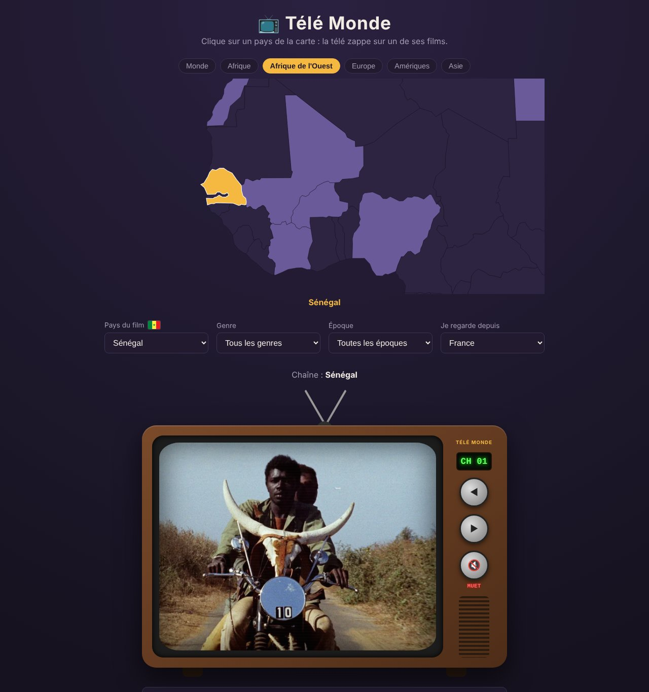
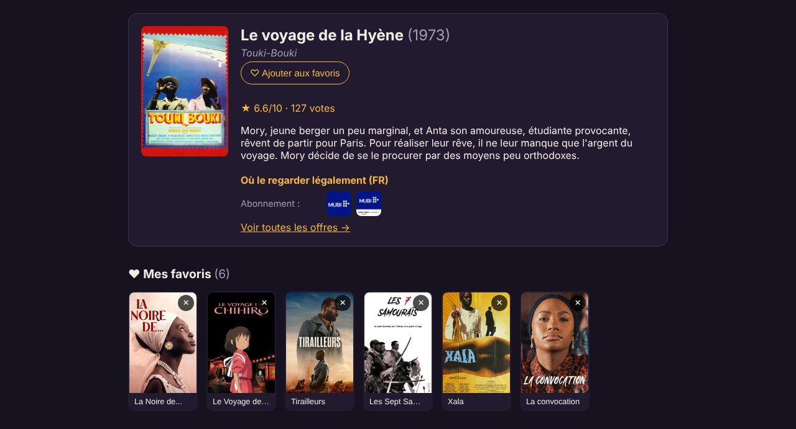
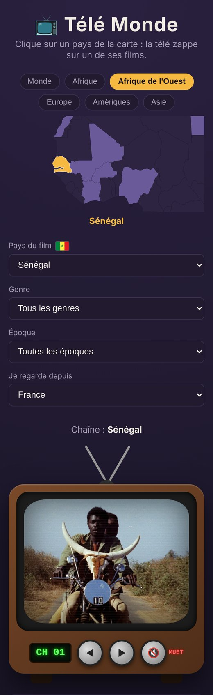

# 📺 Télé Monde

### 👉 [Essayer l'appli : sama-tele.vercel.app](https://sama-tele.vercel.app/)

Une télé rétro : clique sur un pays de la carte, elle zappe sur un film de ce pays et passe sa **bande-annonce officielle**.
Elle affiche aussi les infos du film et **où le regarder légalement**.



## Fonctions

- 🗺️ **Carte du monde cliquable**, avec zoom par continent (dont l'Afrique de l'Ouest)
- 🎬 **Bande-annonce officielle** lue depuis YouTube ; si elle ne marche pas, la télé essaie la suivante puis affiche l'affiche du film
- 🎛️ **Filtres** par genre et par époque
- 📍 **Où regarder le film légalement** selon ton pays (données JustWatch)
- ♥ **Favoris** gardés dans le navigateur, avec une « chaîne Favoris » pour zapper entre eux
- ⌨️ **Télécommande au clavier** : ← → pour zapper, chiffres pour aller à une chaîne, M pour le son, F pour les favoris
- 📱 Fonctionne sur téléphone
- 🔒 Clé TMDB cachée derrière un serveur : elle n'est jamais envoyée au navigateur

<p>
  
  
</p>

## Technologies

React 19 · Vite · API TMDB · API du lecteur YouTube · d3-geo + topojson (carte) · fonction serveur Vercel

## Lancer le projet sur son ordi

```bash
npm install
cp .env.example .env   # puis mets ta clé TMDB dans .env
npm run dev
```

Ouvre ensuite http://localhost:5173

Après un `git pull`, refais `npm install` si `package.json` a changé.

## Obtenir une clé TMDB

1. Crée un compte sur https://www.themoviedb.org
2. Paramètres → API → « Request an API Key » → Developer
3. Copie l'**API Key (v3)** dans `.env` : `TMDB_API_KEY=...`

## Mettre le site en ligne (Vercel, gratuit)

1. Crée un compte sur https://vercel.com avec ton compte GitHub.
2. **Add New → Project**, puis choisis le dépôt `sama-tele` → **Import**.
3. Vercel reconnaît Vite tout seul. Ouvre **Environment Variables** et ajoute :
   - Name : `TMDB_API_KEY`
   - Value : ta clé TMDB
4. Clique sur **Deploy**. Tu obtiens un lien du type `https://sama-tele.vercel.app`.

Ensuite, chaque `git push` sur `main` met le site à jour automatiquement.

## Comment la clé reste secrète

```
Navigateur ──/api/tmdb──▶ Serveur (connaît la clé) ──▶ TMDB
```

- Le navigateur n'appelle jamais TMDB directement : il appelle `/api/tmdb`.
- `server/tmdbProxy.js` ajoute la clé et ne laisse passer que les 4 adresses TMDB utilisées par l'appli.
- En ligne, c'est `api/tmdb.js` (fonction Vercel) qui l'utilise ; en local, c'est un petit plugin dans `vite.config.js`.
- La variable s'appelle `TMDB_API_KEY` et pas `VITE_...` : Vite n'envoie au navigateur que les variables qui commencent par `VITE_`.

## Structure

```
api/tmdb.js              fonction serveur Vercel (/api/tmdb)
server/tmdbProxy.js      l'intermédiaire qui ajoute la clé (utilisé en local et en ligne)
src/tmdb.js              appels à l'API depuis l'appli
src/countries.js         pays, décennies, zones de zoom
src/App.jsx              état de l'appli et assemblage
src/useFavorites.js      favoris (localStorage)
src/useRemote.js         télécommande clavier
src/components/          Tv, YouTubePlayer, Static, MovieInfo, Favorites, WorldMap
```

## Droits d'auteur

Cette application **n'héberge et ne diffuse aucun film**.

- Les bandes-annonces sont lues depuis YouTube via le lecteur officiel.
- Les informations et affiches viennent de l'API TMDB.
- Les offres de streaming viennent de JustWatch (via TMDB).

This product uses the TMDB API but is not endorsed or certified by TMDB.
